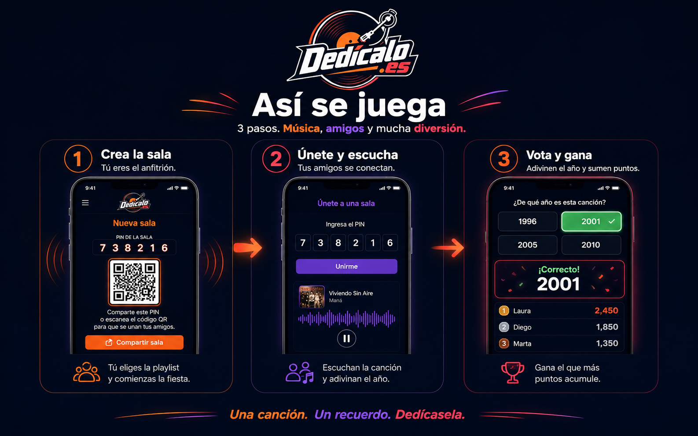

<div align="center">


<a href="https://play.dedicalo.es"></a>

<a href="https://play.dedicalo.es"></a>

</div>

## 🧭 Overview
A music party game for groups: a song plays, the music stops, and each player guesses the year to complete their route. Real-time multiplayer.

## ✨ Features
- Real-time multiplayer rounds
- Music-based guessing mechanics
- Installable PWA + mobile (Capacitor)
- Firebase backend

## 🛠️ Built with
`React` · `Vite` · `Firebase` · `Capacitor` · `AI`

## 🚀 Run locally
```bash
npm install
npm run dev
```

## 📚 Project documentation

<details>
<summary>Original project README</summary>

# Dedicalo Play

Juego musical de fiesta para grupos presenciales. Suena una cancion, se corta
la musica, y cada jugador adivina de que ano es para completar su ruta.

**Produccion:** [play.dedicalo.es](https://play.dedicalo.es) · **Version:** v0.4.0

## Documentacion

| | |
|---|---|
| [Concepto](docs/01-concepto.md) | Que es, para quien, por que |
| [Game Design Document](docs/02-gdd.md) | Mecanicas, reglas, economia |
| [Arquitectura](docs/03-arquitectura.md) | Stack, datos, decisiones tecnicas |
| [Marca](docs/04-marca.md) | Identidad, paleta, tipografia |
| [Roadmap](docs/05-roadmap.md) | Hitos hasta la v1.0 |
| [Trazabilidad](docs/06-trazabilidad.md) | Prueba de autoria y evolucion |
| [Decisiones (ADR)](docs/decisiones/) | Por que se hizo cada cosa |
| [Registro de cambios](CHANGELOG.md) | Historial de versiones |

> **Nota:** antes de cualquier plan comercial, leer
> [ADR-0002](docs/decisiones/0002-dependencia-de-spotify.md) — la base musical
> actual bloquea el modelo de cobro.

## Desarrollo

```bash
npm install
npm run dev
```

## Validacion

```bash
npm run lint
npm run build
```

## Publicar en Vercel con `play.dedicalo.es`

1. Sube este proyecto a GitHub o importa la carpeta `dedicalo-app` en Vercel.
2. En Vercel usa:
   - Framework: `Vite`
   - Build command: `npm run build`
   - Output directory: `dist`
3. En el proyecto de Vercel, anade el dominio `play.dedicalo.es`.
4. En Hostinger, abre la zona DNS de `dedicalo.es` y cambia `play.dedicalo.es` para que apunte a Vercel:
   - Borra los registros `A` actuales del host `play` si apuntan a Hostinger.
   - Crea un registro:
     - Tipo: `A`
     - Nombre/Host: `play`
     - Valor/Destino: `76.76.21.21`
5. En Firebase Console, anade `play.dedicalo.es` como dominio autorizado en Authentication > Settings > Authorized domains.

`vercel.json` ya esta configurado para que las rutas internas del juego funcionen al recargar.

## Publicar en Firebase Hosting

Si prefieres Firebase Hosting:

```bash
npm run build
npx firebase-tools login
npx firebase-tools deploy --only hosting,database
```

Despues, en Firebase Hosting > Add custom domain, anade `play.dedicalo.es` y copia los registros DNS que Firebase indique en Hostinger.

## Spotify

La app usa enlaces publicos de playlists de Spotify. No necesita `client_secret` en el frontend. Si mas adelante se integra la API real de Spotify, el secreto debe ir en una funcion serverless o backend, nunca en variables `VITE_*`.

</details>


---

<div align="center">
<sub>Made by <b>Rodrigo Negrete</b> — AI Product Designer &amp; Automation Architect<br/>
<a href="https://www.rodrigonegrete.es">Portfolio</a> · <a href="https://linkedin.com/in/rodrigonegretearos">LinkedIn</a> · <a href="https://github.com/Ronegret">GitHub</a></sub>
</div>
